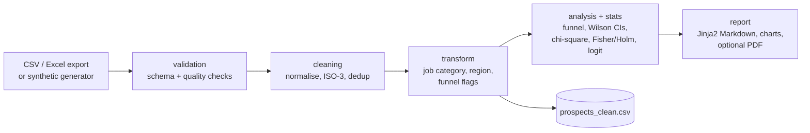

# Marketing Report Generator

A Python pipeline for marketing and analytics teams that turns a prospect-level marketing export into a funnel and channel report with statistical tests attached: confidence intervals, significance tests and a multivariable model.

[](https://github.com/gcfialho/marketing-report-generator/actions/workflows/ci.yml) [](https://www.python.org/) [](LICENSE)


*Chart from the example report in [`examples/synthetic/`](examples/synthetic/example-co-marketing-report.md), generated from synthetic data.*

The project began as an analytics case study and has been rebuilt as a standalone, tested package.

## Highlights

- **Data cleaning on messy CRM exports:** validates the schema, normalises whitespace and missing values, maps free-text countries to ISO-3 codes, standardises funnel statuses and keeps one row per prospect (the furthest funnel stage wins).
- **Sound statistics for small segments:** Wilson intervals, chi-square with Cramér's V, Fisher's exact test with Holm correction, and a treatment-coded logistic regression with odds ratios. A channel action is recommended only where the evidence supports it.
- **Packaging and tooling:** typed `src/` package, a CLI configured by flags or environment variables, Jinja2 report templates, uv for dependencies, ruff, pytest and GitHub Actions CI.
- **No proprietary data needed:** a seeded synthetic generator produces the same 14-column schema with realistic data-quality issues, so the pipeline runs end to end without any private data.

## Quickstart

Requires [uv](https://docs.astral.sh/uv/).

```bash
git clone https://github.com/gcfialho/marketing-report-generator.git
cd marketing-report-generator
uv sync

# Run on synthetic data (the default when no input is given)
uv run marketing-report run --output-dir output

# Run on your own export
uv run marketing-report run --input path/to/prospects.xlsx --company "Acme Corp"
```

Output in `output/`: `<company>-marketing-report.md`, `charts/*.png` and `prospects_clean.csv`.

For PDF output, install the optional extra. It pulls in PyMuPDF, which is a large dependency:

```bash
uv sync --extra pdf
uv run marketing-report run --pdf
```

## How it works



| Module | Responsibility |
|---|---|
| `validation.py` | Load CSV/Excel, check required columns, profile missing values, duplicates and unknown statuses |
| `cleaning.py` | Whitespace and missing-value normalisation, country and status standardisation, prospect deduplication |
| `transform.py` | Whole-word keyword rules for job category, seniority and channel group; ISO-3 to region; cumulative funnel flags |
| `stats.py` | Wilson intervals, chi-square with Cramér's V, Fisher's exact test with Holm correction, treatment-coded logistic regression |
| `analysis.py` | Funnel steps and bottleneck, segment tables, findings, evidence-gated channel actions |
| `report.py`, `charts.py` | Jinja2 Markdown template, matplotlib charts, optional PDF via `markdown-pdf` |
| `pipeline.py`, `cli.py` | Orchestration with per-step timing and logging; the `marketing-report` CLI |
| `synthetic.py` | Seeded generator with the same 14-column schema and realistic data-quality issues |

### CLI usage

```text
marketing-report run   [-i INPUT | --synthetic] [--rows N] [--seed S] [-o OUTPUT_DIR]
                       [--company NAME] [--objective TEXT] [--alpha 0.05]
                       [--pdf] [--no-clean-export]
marketing-report synth -o OUTPUT.{csv,xlsx} [--rows N] [--seed S] [--tidy]
```

| Option | Default | Environment variable |
|---|---|---|
| `--input` | none (synthetic data) | `MARKETING_REPORT_INPUT` |
| `--output-dir` | `output` | `MARKETING_REPORT_OUTPUT_DIR` |
| `--company` | `Example Co.` | `MARKETING_REPORT_COMPANY` |
| `--objective` | `Maximise free-trial registrations` | `MARKETING_REPORT_OBJECTIVE` |

`synth` writes a synthetic dataset to disk. `--tidy` turns off the injected data-quality issues.

**Input schema.** Required columns: `Prospect Status`, `Prospect Source`, `Country`, `Job Title`. Optional columns: `Campaign ID`, `Campaign Name`, `Account ID`, `Account Name`, `domain`, `Prospect ID`, `Opt-In`, `Opt-In Source`, `Opt-In Timestamp`, `Opt-Out Timestamp`. `Prospect Status` must be one of `Responded`, `No Show`, `Attended` or `Registered`; common spelling variants are mapped automatically.

## Results

These numbers come from the example report on **synthetic data** (1,000 generated prospects, seed 42). They show what the pipeline outputs; they say nothing about any real business.

| Metric | Value |
|---|---|
| Trial registrations | 108 of 1,000 (10.8%) |
| Demo attendance (attended / demo outcome known) | 26.2% (234 of 894): the weakest funnel step |
| Registration among demo attendees | 46.2% (108 of 234) |
| Channel rates (95% Wilson CI) | Trade Show 15.9% (10.5 to 23.2%), Referral 15.2% (6.7 to 30.9%), Advertisement 10.1% (8.3 to 12.4%), Social Media 0 of 23 (0 to 14.3%) |
| Channel difference | Chi-square p = 0.067 (flagged for low expected counts). No channel differs from the rest after Holm correction, so every channel is "Hold" |
| Logistic regression | Likelihood-ratio p = 0.262, McFadden pseudo-R² = 0.015 |

## Methodology

| Question | Method | Why this method |
|---|---|---|
| How far do prospects get? | Cumulative funnel. Attendance rate = attended / (attended + no-show); registration rate = registered / attended | `Prospect Status` stores the furthest stage reached, so stages must be cumulative. The bottleneck is the weakest step, not the most common status |
| How reliable is a segment's rate? | 95% Wilson score interval | Stays valid for small segments and 0% rates. A channel with 0 of 14 registrations has an upper bound of about 21%, which is not evidence that the channel never converts |
| Do segments convert differently? | Chi-square test on segment × registered, with Cramér's V | Tests the conversion question directly. The report flags low expected counts |
| Which segments stand out? | Fisher's exact test against all other prospects, Holm-adjusted | Exact for small cells, and corrected for testing many segments at once |
| What matters when channel, region and role are considered together? | Logistic regression with treatment coding, reported as odds ratios with 95% CIs | Nominal variables are not integer-encoded. Levels that would cause separation are excluded and listed in the report |
| Where should effort move? | *Increase*/*Decrease* only at adjusted p < α, otherwise *Hold*; volume shares renormalised to 100% | Avoids acting on noise. The report says explicitly that the input has no spend data |

More detail: [docs/design-decisions.md](docs/design-decisions.md).

## Project structure

```text
├── src/marketing_report/     # the package (see the module table above)
│   └── templates/report.md.j2
├── tests/                    # unit tests + end-to-end tests on synthetic data
├── examples/synthetic/       # example report generated with the default seed
├── docs/design-decisions.md  # methodology and trade-offs
├── .github/workflows/ci.yml  # ruff, pytest and a CLI smoke test
└── pyproject.toml / uv.lock
```

## Testing

```bash
uv run ruff check
uv run ruff format --check
uv run pytest
```

The tests cover each pipeline stage on small hand-built fixtures, regression tests for earlier bugs (country-to-region lookup, substring keyword matches), the statistics helpers against known values, and end-to-end runs of the pipeline and CLI on synthetic data. CI runs all of this on Python 3.12 and 3.13.

## Limitations & roadmap

Limitations:

- **No cost data**, so the pipeline cannot estimate CPA, ROAS or ROI. The channel scenario shifts prospect *volume* share, not budget.
- **Attribution is single-touch** (`Prospect Source`) and campaigns were not randomised. Model coefficients are associations, not causal effects.
- **Job categories come from keyword rules** on free-text titles and will misclassify some of them.
- **Synthetic data is illustrative.** Its effect sizes are modest and invented.
- **The analysis is a snapshot**: there is no time-series or cohort analysis yet.

Roadmap:

- Join spend data to report cost per registration by channel and support budget optimisation under constraints.
- Trend and cohort views using the opt-in timestamps.
- Pydantic or pandera schema contracts for the input file.
- An optional dashboard view (for example Streamlit) built on the same analysis objects.

## Author

Guilherme Fialho · Machine Learning Engineer (GenAI/LLMs) and Data Engineer · [LinkedIn](https://www.linkedin.com/in/guilherme-cagide-fialho/) · [GitHub](https://github.com/gcfialho)

Licensed under the [MIT License](LICENSE).
