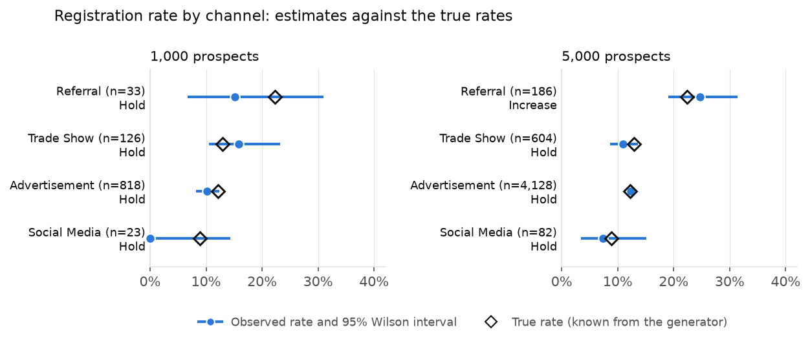
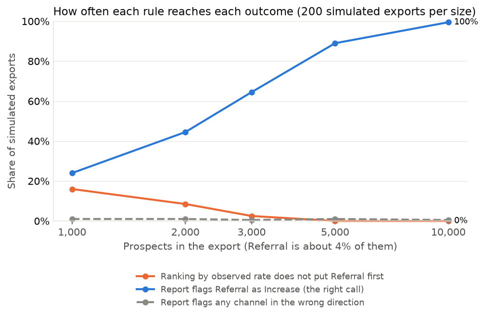

# Worked example: should more prospects go through Referral?

This example takes one business question through the pipeline and checks the answer against the
truth. The data is synthetic, so the true registration rate of every channel is known from the
generator's parameters (`synthetic.true_registration_rates()`). Nothing here describes a real
company.

## The question

The [default example report](../synthetic/example-co-marketing-report.md) covers 1,000 prospects.
Ranked by observed registration rate, Trade Show comes first at 15.9%, Referral is close behind at
15.2%, and Advertisement, which brings 81.8% of prospects, converts at 10.1%. Should the team send
more prospects through Trade Show or Referral?

## Short answer

**Not on 1,000 prospects.** The report marks every channel *Hold*. Referral has only 33 prospects,
so the test would flag it only if its true rate were below 0.1% or above 34.5%. Picking the channel
with the highest observed rate would have chosen Trade Show, whose true rate (13.0%) is close to
Advertisement's. The channel that really converts better is Referral (22.3% against 12.2% for all
other prospects). With about 5,000 prospects (a median of 198 from Referral), the same rule flags it
in at least 80% of simulated exports, and it flagged a channel in the wrong direction in at most 1%
of exports.

## 1. What the 1,000-prospect report says

| Channel | Prospects | Observed rate | 95% interval | True rate | Action | Flagged only if true rate is |
|---|---:|---:|---:|---:|---|---|
| Trade Show | 126 | 15.9% | 10.5% to 23.2% | 13.0% | Hold | below 2.7% or above 21.5% |
| Referral | 33 | 15.2% | 6.7% to 30.9% | 22.3% | Hold | below 0.1% or above 34.5% |
| Advertisement | 818 | 10.1% | 8.3% to 12.4% | 12.2% | Hold | below 5.8% or above 24.4% |
| Social Media | 23 | 0.0% | 0.0% to 14.3% | 8.9% | Hold | above 40.6% |

Every 95% interval contains the true rate. The intervals are wide where the data is thin: Referral's
runs from 6.7% to 30.9%.



## 2. The same question with 5,000 prospects

| Channel | Prospects | Observed rate | 95% interval | True rate | Action | Flagged only if true rate is |
|---|---:|---:|---:|---:|---|---|
| Referral | 186 | 24.7% | 19.1% to 31.4% | 22.3% | Increase | below 5.2% or above 21.3% |
| Advertisement | 4,128 | 12.4% | 11.4% to 13.4% | 12.2% | Hold | below 9.6% or above 18.1% |
| Trade Show | 604 | 10.9% | 8.7% to 13.7% | 13.0% | Hold | below 8.4% or above 18.0% |
| Social Media | 82 | 7.3% | 3.4% to 15.1% | 8.9% | Hold | below 3.1% or above 27.3% |

Referral is now flagged *Increase* (24.7% against 12.1% for the rest, Holm-adjusted p < 0.001).
Every interval still contains the true rate.

The per-channel funnel table in the report shows where the gap comes from. At 5,000 prospects,
Referral: attendance 42.1% (35.0% to 49.6%), registration after attending 63.9% (52.4% to 74.0%).
Advertisement: attendance 25.5% (24.1% to 26.9%), registration after attending 53.5% (50.3% to
56.6%). Most of Referral's advantage is at demo attendance (the generator uses 40% against 26%), so
a reminder or scheduling change for demo invitees is a cheaper first test than moving volume.

## 3. How often each rule gets it right

One dataset can be lucky. The script repeats the analysis on 200 independently generated exports at
each size and counts outcomes.

| Prospects | Referral prospects (median) | Observed ranking does not put Referral first | Report flags Referral as *Increase* | Report flags a channel in the wrong direction | Wilson interval coverage (target 95%) |
|---:|---:|---:|---:|---:|---|
| 1,000 | 41 | 16% | 24% | 1% | 95.2% (lowest channel 93.5%) |
| 2,000 | 81 | 8% | 44% | 1% | 94.5% (lowest channel 93.5%) |
| 3,000 | 120 | 2% | 64% | 0% | 95.6% (lowest channel 94.5%) |
| 5,000 | 198 | 0% | 89% | 1% | 95.0% (lowest channel 93.0%) |
| 10,000 | 400 | 0% | 100% | 0% | 95.4% (lowest channel 92.0%) |



- Ranking channels by observed rate always gives an answer. Because Referral's true advantage is
  large, the ranking is usually right, but at 1,000 prospects it puts another channel first in 16%
  of exports, and nothing in a ranking says which exports those are.
- The report's rule (Fisher's exact test against the other channels, Holm-corrected) is
  conservative. At 1,000 prospects it flags Referral in only 24% of exports and otherwise says
  *Hold*. That is the price of not acting on noise: across all sizes it flagged a channel in the
  wrong direction in at most 1% of exports. The *Flagged only if true rate is* column tells the
  reader when a *Hold* means "not enough data".
- The Wilson intervals cover the true rate close to the 95% they promise, including for the small
  Social Media and Referral segments.

## 4. A false positive in the default report

The default report says conversion by job category differs significantly (Holm-adjusted p = 0.027).
That result is driven by *Other* at 22.9% (11 of 48), but the generator gives *Other* the same
registration probability as *Practitioner*. Job category only multiplies the registration step, by
0.9 for executives and 1.05 for decision makers. At a 5% significance level some results like this
are expected. The safeguards hold: no single category passes its own corrected test (*Other* against
the rest: Holm-adjusted p = 0.054), and the report recommends no action on job category.

## What the team should do

1. Keep the current channel mix for now. The data does not yet support moving volume.
2. Keep collecting: at the current mix, about 5,000 prospects are needed before a real Referral
   advantage of this size is detected reliably.
3. Test a demo-attendance intervention, since attendance is the weakest step overall and where most
   of the Referral gap sits.
4. Add spend per channel before any budget decision. Without it the report can only talk about
   prospect volume, not cost per registration.

## Reproduce

```bash
uv run python examples/channel-decision/build.py           # 200 runs per size, a few minutes
uv run python examples/channel-decision/build.py --runs 20 # quick check
uv run python examples/channel-decision/build.py --reuse   # rebuild text and charts only
```

The script writes this README, both charts and `simulation.csv` (one row per simulated export).