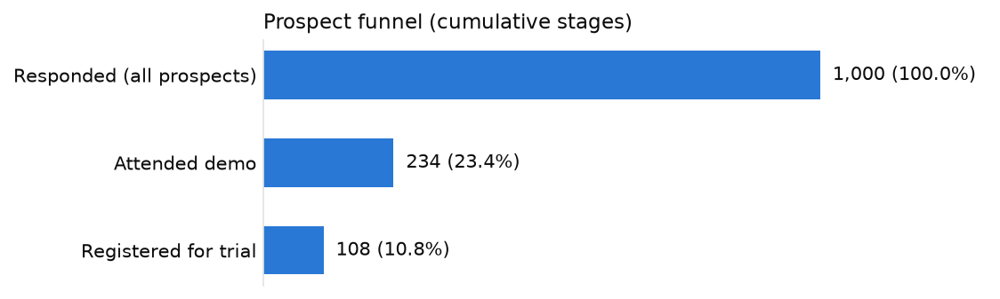
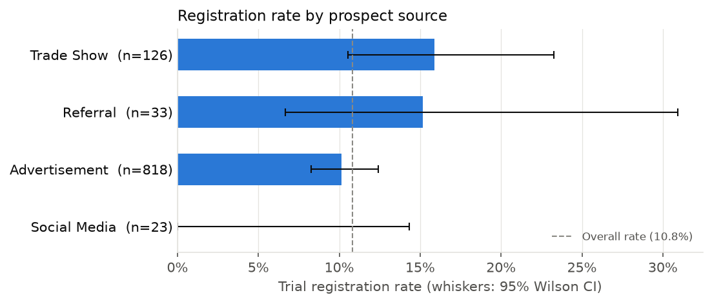
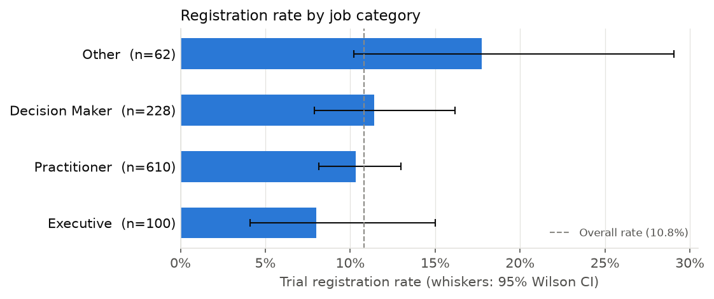

# Marketing Funnel Report: Example Co.

- **Objective:** Maximise free-trial registrations
- **Data source:** `synthetic (rows=1000, seed=42)`
- **Opt-in period covered:** 2023-01-15 to 2023-11-30
- **Generated:** 2026-10-19 12:21
- **Significance level:** α = 0.05

## Executive summary

- 108 of 1,000 prospects registered for a trial (10.8%).
- Weakest funnel step: Demo attendance (attended / demo outcome known) at 26.2% (234 of 894).
- Conversion rates by channel do not differ significantly (chi-square = 7.16, df = 3, p = 0.067, Cramér's V = 0.08) (some expected counts < 5; interpret with care).
- Conversion rates by job category do not differ significantly (chi-square = 4.14, df = 3, p = 0.246, Cramér's V = 0.06).
- Conversion rates by region do not differ significantly (chi-square = 1.86, df = 3, p = 0.601, Cramér's V = 0.04).

## 1. Funnel

`Prospect Status` records the furthest stage each prospect reached:
Responded → (No Show | Attended) → Registered. Stages are therefore cumulative:
every registered prospect also attended a demo.

| Status | Prospects | Share |
|---|---:|---:|
| Responded | 106 | 10.6% |
| No Show | 660 | 66.0% |
| Attended | 126 | 12.6% |
| Registered | 108 | 10.8% |
| **Total** | **1,000** | 100.0% |

| Funnel step | Converted | Base | Rate |
|---|---:|---:|---:|
| Demo attendance (attended / demo outcome known) | 234 | 894 | 26.2% |
| Trial registration (registered / attended) | 108 | 234 | 46.2% |
| Overall (registered / all prospects) | 108 | 1,000 | 10.8% |

106 prospects are still at *Responded* (no demo outcome recorded) and are
excluded from the attendance-rate base.

## 2. Channel performance

| Prospect Source | Prospects | Registered | Rate | 95% CI | Volume share | Adj. p vs rest |
|---|---:|---:|---:|---:|---:|---:|
| Trade Show | 126 | 20 | 15.9% | 10.5% to 23.2% | 12.6% | 0.256 |
| Referral | 33 | 5 | 15.2% | 6.7% to 30.9% | 3.3% | 0.487 |
| Advertisement | 818 | 83 | 10.1% | 8.3% to 12.4% | 81.8% | 0.487 |
| Social Media | 23 | 0 | 0.0% | 0.0% to 14.3% | 2.3% | 0.487 |

*Chi-square test of independence: χ² = 7.16, df = 3, p = 0.067, Cramér's V = 0.08. Caution: smallest expected count is 2.5 and 25% of cells are below 5, so the chi-square approximation is unreliable; rely on the exact per-segment tests.*

## 3. Audience and geography

### Job category

| Job Category | Prospects | Registered | Rate | 95% CI | Volume share | Adj. p vs rest |
|---|---:|---:|---:|---:|---:|---:|
| Other | 62 | 11 | 17.7% | 10.2% to 29.0% | 6.2% | 0.350 |
| Decision Maker | 228 | 26 | 11.4% | 7.9% to 16.2% | 22.8% | 1.000 |
| Practitioner | 610 | 63 | 10.3% | 8.2% to 13.0% | 61.0% | 1.000 |
| Executive | 100 | 8 | 8.0% | 4.1% to 15.0% | 10.0% | 1.000 |

*Chi-square test of independence: χ² = 4.14, df = 3, p = 0.246, Cramér's V = 0.06.*

### Region

| Geographic Region | Prospects | Registered | Rate | 95% CI | Volume share | Adj. p vs rest |
|---|---:|---:|---:|---:|---:|---:|
| Asia Pacific | 183 | 22 | 12.0% | 8.1% to 17.5% | 18.3% | 1.000 |
| North America | 390 | 45 | 11.5% | 8.7% to 15.1% | 39.0% | 1.000 |
| Europe | 319 | 33 | 10.3% | 7.5% to 14.2% | 31.9% | 1.000 |
| Latin America | 108 | 8 | 7.4% | 3.8% to 13.9% | 10.8% | 1.000 |

*Chi-square test of independence: χ² = 1.86, df = 3, p = 0.601, Cramér's V = 0.04.*

### Country

| Country | Prospects | Registered | Rate | 95% CI | Volume share | Adj. p vs rest |
|---|---:|---:|---:|---:|---:|---:|
| ARG | 24 | 4 | 16.7% | 6.7% to 35.9% | 2.4% | 1.000 |
| FRA | 44 | 6 | 13.6% | 6.4% to 26.7% | 4.4% | 1.000 |
| MEX | 53 | 7 | 13.2% | 6.5% to 24.8% | 5.3% | 1.000 |
| CHN | 84 | 11 | 13.1% | 7.5% to 21.9% | 8.4% | 1.000 |
| IND | 72 | 9 | 12.5% | 6.7% to 22.1% | 7.2% | 1.000 |
| USA | 262 | 32 | 12.2% | 8.8% to 16.7% | 26.2% | 1.000 |
| GBR | 161 | 18 | 11.2% | 7.2% to 17.0% | 16.1% | 1.000 |
| DEU | 9 | 1 | 11.1% | 2.0% to 43.5% | 0.9% | 1.000 |
| ESP | 98 | 8 | 8.2% | 4.2% to 15.3% | 9.8% | 1.000 |
| CAN | 75 | 6 | 8.0% | 3.7% to 16.4% | 7.5% | 1.000 |
| JPN | 27 | 2 | 7.4% | 2.1% to 23.4% | 2.7% | 1.000 |
| BRA | 84 | 4 | 4.8% | 1.9% to 11.6% | 8.4% | 0.859 |
| ITA | 7 | 0 | 0.0% | 0.0% to 35.4% | 0.7% | 1.000 |

*Chi-square test of independence: χ² = 8.45, df = 12, p = 0.749, Cramér's V = 0.09. Caution: smallest expected count is 0.8 and 19% of cells are below 5, so the chi-square approximation is unreliable; rely on the exact per-segment tests.*

## 4. Multivariable logistic regression

Model: `is_registered ~ Prospect Source + Geographic Region + Job Category` on 977 prospects
(108 registrations). Odds ratios are relative to the reference level of each
variable (Prospect Source = Advertisement; Geographic Region = North America; Job Category = Practitioner),
holding the other variables fixed.

| Term | Odds ratio | 95% CI | p-value |
|---|---:|---:|---:|
| Prospect Source: Referral | 1.62 | 0.60 to 4.32 | 0.339 |
| Prospect Source: Trade Show | 1.70 | 1.00 to 2.90 | 0.052 |
| Geographic Region: Asia Pacific | 1.10 | 0.63 to 1.91 | 0.735 |
| Geographic Region: Europe | 0.92 | 0.57 to 1.48 | 0.718 |
| Geographic Region: Latin America | 0.59 | 0.27 to 1.30 | 0.190 |
| Job Category: Decision Maker | 1.09 | 0.67 to 1.78 | 0.716 |
| Job Category: Executive | 0.78 | 0.36 to 1.69 | 0.528 |
| Job Category: Other | 2.06 | 1.01 to 4.20 | 0.047 |

McFadden pseudo-R² = 0.015; likelihood-ratio test against the
intercept-only model: p = 0.262.

Excluded from the model because they are too small or have no variation in the outcome
(maximum likelihood cannot estimate them): Prospect Source: Social Media.
These levels still appear in the descriptive tables above.

## 5. Channel actions and volume-mix scenario

A channel is marked *Increase* or *Decrease* only when its registration rate differs from
the other channels at Holm-adjusted p < 0.05 (Fisher's exact test); otherwise *Hold*.
The scenario multiplies each channel's share of prospect volume by
1.25 / 0.75 / 1.0 and renormalises to 100%.
The dataset contains **no spend or cost data**, so these are shares of prospect volume, not of
budget, and no ROI or CAC figures are implied.

| Channel | Action | Current volume share | Scenario share | Rationale |
|---|---|---:|---:|---|
| Trade Show | Hold | 12.6% | 12.6% | No significant difference vs. other channels (adj. p = 0.256) |
| Referral | Hold | 3.3% | 3.3% | No significant difference vs. other channels (adj. p = 0.487) |
| Advertisement | Hold | 81.8% | 81.8% | No significant difference vs. other channels (adj. p = 0.487) |
| Social Media | Hold | 2.3% | 2.3% | No significant difference vs. other channels (adj. p = 0.487) |

## 6. Data quality

- Input rows: 1,003 across 14 columns; cell completeness 91.7%.
- Duplicate prospect IDs in the input: 3.
- Missing values by column: Opt-In (14), Opt-In Source (125), Opt-In Timestamp (50), Opt-Out Timestamp (975).
- Rows after cleaning: 1,000 (removed: 0 empty, 0 invalid status, 3 duplicates).

Cleaning steps:
1. Trimmed and collapsed whitespace in text columns; blank strings set to missing
2. Standardised country names to ISO 3166-1 alpha-3 codes
3. Standardised Prospect Status values
4. Parsed opt-in/opt-out timestamps (unparseable values set to missing)
5. Removed 3 duplicate prospect rows (kept furthest funnel stage, then most recent opt-in)

## 7. Methodology and limitations

- Rates use 95% Wilson score intervals, which remain valid for small segments and rates near 0%.
- Segment differences are tested with a chi-square test of independence on the
  segment × registered table, with Cramér's V as effect size. Results are flagged when expected
  counts are too small for the chi-square approximation.
- Per-segment comparisons use Fisher's exact test (segment vs. all others) with Holm correction
  for multiple comparisons.
- The logistic regression uses one-hot (treatment) coding; odds ratios are associations, not
  causal effects. Prospect source is a single-touch attribution field and campaigns were not
  randomised.
- No cost data is available, so cost-efficiency (CPA, ROAS) cannot be estimated.
- Job categories and seniority are derived from free-text job titles with keyword rules and will
  misclassify some titles.
